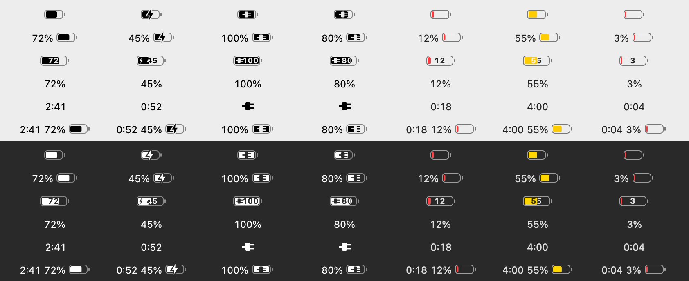
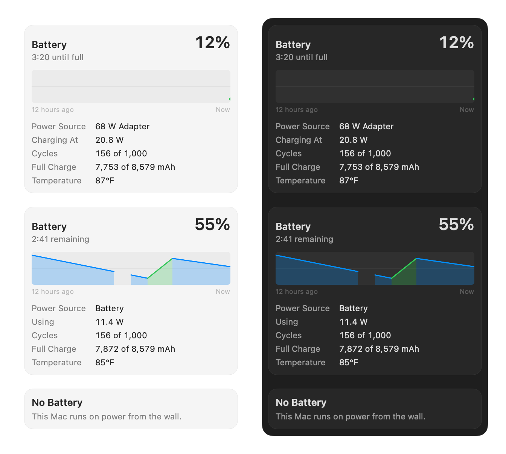

# Common Battery

[](https://github.com/oddurs/common-tools/actions/workflows/ci.yml)
[](LICENSE)

The battery in the macOS menu bar, done properly: the level, the time left, and what the battery is doing, plus alerts when it runs low or reaches your charge level. It replaces the system's battery icon. **[oddurs.github.io/common-tools/battery](https://oddurs.github.io/common-tools/battery/)**



Common Battery is built to feel like part of macOS:

- **The menu bar draws it.** The icon is a template image, so macOS tints it for light and dark menu bars and inactive displays, like the system's own. It turns red when low and yellow in Low Power Mode, as the system's does; turn that off and it stays monochrome.
- **A time remaining that learns.** macOS divides the charge left by the last minute's draw, so the time leaps when a build starts and balloons when the screen dims. Common Battery learns how this Mac is used, on the Mac, and counts down steadily instead. Details under [Time remaining](#time-remaining).
- **Show what you want, in the order you want.** The item has three parts: the battery icon, the percentage, and the time remaining. Show any of them, even just the time, and drag them into order. The icon can carry the percentage inside it, cut out of the charge. The item's width never changes with the level, so it never nudges the icons beside it, and what it shows sits in its middle.
- **The dropdown is a real menu.** It shows the level and status, a chart of the last 12 hours with time on the charger in green, and the details: power source and adapter wattage, live watts in or out, cycle count, full-charge capacity, and temperature.
- **Alerts you choose.** A notification as the battery drains to 10–30%, and one as it charges to 80, 90, or 100%. Each comes once per crossing, not every minute after.
- **VoiceOver reads it:** "Battery 72%, 2:41 remaining".
- **Numbers follow your region:** "12,4 W" in Germany, 85°F in the US.

Free forever and open source under the MIT licence. Private: no analytics, no crash reports, no account; nothing you do is ever reported. No network access, no helper tools, no root.

## Install

Requires macOS 14 or later.

1. Download [CommonBattery.zip](https://oddurs.github.io/common-tools/battery/) from the [latest release](https://oddurs.github.io/common-tools/battery/), unzip it, and move **Common Battery** to Applications.
2. Open it. The build is signed but not notarized, so the first time macOS will say it can't verify the developer. Go to **System Settings › Privacy & Security** and click **Open Anyway**. Alternatively, run:

   ```sh
   xattr -dr com.apple.quarantine "/Applications/Common Battery.app"
   ```

3. Choose **Settings…** from its menu. Click **Open Control Center Settings…** and set **Battery** to **Don't Show in Menu Bar**, so only one battery shows. Turn on **Open at login**.

## Usage

Click the item for the menu. **Battery Settings…** opens the system's Battery pane, for Low Power Mode and charging options. **Settings…** (⌘,) and **Quit** (⌘Q) are at the bottom.



Settings has four sections. **Menu Bar**: the item as it looks now, to arrange by dragging, with a tray of the parts it isn't showing; click a part to remove it or, for the icon, to show the percentage inside it. Then **Color when low or in Low Power Mode**. Below it, the way to hide the system's battery icon. **Notifications**: **Warn at** and **Tell me when charged to**. **General**: **Open at login**. **Common Tools**: the other apps in the family.

If the item lands behind the camera housing or a menu bar manager, Settings says so. Open Common Battery again from Finder or Spotlight at any time to get Settings.

### Time remaining

A small model predicts the average current of the next hour from the last 5 and 30 minutes of draw, the time of day, and Low Power Mode. Time remaining is the charge left divided by that. Every minute on battery, the minute from an hour earlier becomes a lesson: the gauge's own count of the charge used since is the answer. The model is recursive least squares with forgetting, so recent weeks count more than old ones, and it is 42 numbers kept in the app's preferences. Nothing leaves the Mac.

It is used only when it has earned it:

- macOS's figure shows until about an hour of predictions has been scored.
- Each prediction is scored against what happened, alongside the 30-minute average alone and the current right now (macOS's method). The best of the three is chosen when a stretch on battery starts, and kept to its end. When macOS's method scores best, macOS's figure shows.
- What's shown counts down a minute a minute, easing toward the estimate by at most 1% of itself per minute, so "4:00" never leaps to "5:30". A real change, like starting a game, is fully shown within the hour.

Evidence so far is simulated: `EstimatorTests` runs a month of plausible use (idle, browsing, builds, calls, evening video, mixed by the hour), each session to empty, under three seeds. Against charge ÷ the current right now, the learned time's mean error was 25–58 minutes against 110–133. In 95% of minutes it moved at most 1.5% beyond the countdown, against 32–59%. The comparison stands in for macOS's own estimate, which may smooth more than that. It hasn't been measured on real use yet.

### Accuracy

| Reading | Source | Notes |
| --- | --- | --- |
| Level, state | IOKit power sources | The same source as the system's battery menu and `pmset -g batt`; the tests check against `pmset`. |
| Time remaining | IOKit power sources, then learned | macOS's estimate until the learned one beats it (see above). Time to full is always macOS's. Shown only while the battery is charging or discharging. |
| Charge left | AppleSmartBattery `AppleRawCurrentCapacity` | mAh; what the learned time divides. The tests check against `ioreg`. |
| Power source, adapter | IOKit power sources | The adapter's rated wattage. |
| Watts | AppleSmartBattery `Voltage` × `Amperage` | Power into or out of the battery itself. |
| Cycle count | AppleSmartBattery `CycleCount` | The tests check against `ioreg`. Rated cycles come from the power source's `DesignCycleCount`. |
| Full charge | AppleSmartBattery `AppleRawMaxCapacity` and `DesignCapacity` | Measured mAh against design mAh. |
| Temperature | AppleSmartBattery `Temperature` | Hundredths of a degree Celsius. |

Every source is public and unprivileged. A value that can't be read isn't shown, never a made-up zero.

#### Not included, and why

- **Maximum Capacity as a percentage.** System Settings' figure comes from a calculation Apple doesn't publish. On the Mac this was built on, it says 96% while the measured mAh say 92%. A second percentage that disagrees with System Settings would mislead, so the menu shows the mAh.
- **Battery condition.** IOKit's health string disagrees with System Settings' Condition on current Macs (it said "Check Battery" while System Settings said "Normal"). **Battery Settings…** is one click away.
- **Apps using significant energy.** The per-process energy counters available without root miss each app's helper processes, so Chrome, for one, reads as zero. A list that leaves out the biggest users would be wrong.
- **Turning on Low Power Mode.** Changing it needs root. **Battery Settings…** opens the switch.

### Performance

- Common Battery reads the battery when macOS says a power source changed, and once a minute for the chart. While the menu is open it reads every two seconds, so the watts are live.
- A reading takes about 0.2 ms and drawing the item about 0.1 ms. A lesson for the model is a few hundred multiplications. Drawing stops while the item can't be seen; reading stops while the displays sleep.
- The tests fail if reading or drawing gets about 10× slower.

## Build from source

The Command Line Tools are enough; Xcode is not required.

```sh
scripts/task build battery  # universal build → build/battery/Common Battery.app
mv "build/battery/Common Battery.app" /Applications/
```

Notifications need the built app: run bare from `.build`, the app has no bundle and stays quiet.

**Known issue:** on macOS 26, Notification Center refused access to the ad hoc–signed build ("Notifications are not allowed for this application") without asking and without listing the app in System Settings › Notifications. Settings says so when it happens. The menu bar still turns red at 20%.

## Development

Common Battery lives in `apps/battery/` of [oddurs/common-tools](https://github.com/oddurs/common-tools), the monorepo for every Common Tools app, and shares [CommonKit](../../packages/CommonKit) with them. From the repository root:

```sh
scripts/setup                         # once: wire the git hooks
scripts/dev-cert                      # optional, once: a stable signing identity, so permissions survive rebuilds
scripts/task run battery              # build, quit the running copy, open the new one
scripts/task check battery            # lint + test + build, what CI runs for this app
scripts/task test battery --filter=X  # only the tests whose name matches
```

See [CONTRIBUTING.md](../../CONTRIBUTING.md) for the workflow: `scripts/agent start`, `scripts/agent ship`, and `scripts/release battery <version>`.

`swift build && .build/debug/CommonBattery --snapshot out.png` renders six layouts in every state to `out.png`, and the menu (this Mac's battery now, a made-up afternoon, and a Mac without a battery) to `out-menu.png`, each in light and dark. The images above were made this way.

Layout:

- `Sources/BatteryKit`: the sampler, the time estimator and its model, formatting, history, alert decisions, and the menu bar renderer. No UI state, so it can be tested on its own.
- `Sources/CommonBattery`: the status item, menu, notifications, and Settings window.
- `Tests/BatteryKitTests`: unit, accuracy, simulation, and performance tests.

## Licence

MIT. See [LICENSE](../../LICENSE).
