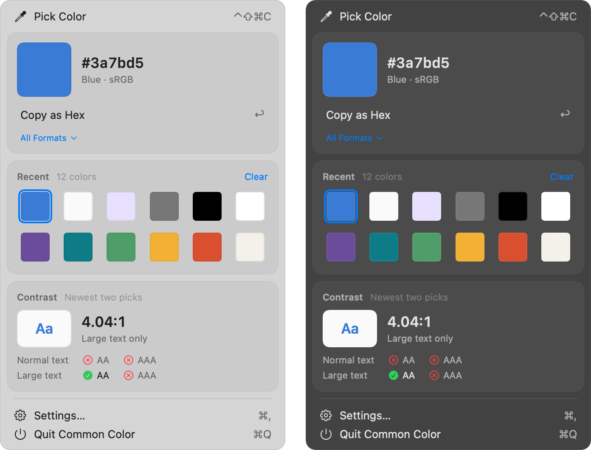

# Common Color

[](https://github.com/oddurs/common-tools/actions/workflows/ci.yml)
[](LICENSE)

Free forever and open source under the MIT licence. Private: no analytics, no crash reports, no account; nothing you do is ever reported, and nothing leaves your Mac. No permission prompts: it needs none.

Pick a colour from anywhere on screen and paste it as code. Press ⌃⇧⌘C, click any pixel, and the colour is on the clipboard in the format you write: hex, CSS, SwiftUI or AppKit, converted correctly from the display's colour space. **[oddurs.github.io/common-tools/color](https://oddurs.github.io/common-tools/color/)**



- **The system's own loupe.** Picking uses macOS's colour sampler, the magnifier the system colour panel uses, so Common Color reads the one pixel you click and never sees your screen. That is why it needs no Screen Recording permission.
- **Every format, one key each.** Hex, `rgb()`, `hsl()`, `oklch()`, `color(display-p3 …)`, SwiftUI `Color(…)` and AppKit `NSColor(…)`. A pick is copied in the one you choose in Settings; in the panel, Return copies that one and 1–7 copy the rest.
- **It says what it copied.** A small card beside the pointer for a moment, with the colour and the exact text, and VoiceOver hears it too. Turn it off in Settings.
- **Converted correctly.** sRGB and Display P3 with the sRGB transfer curve both share, matrices derived from the published primaries, and OKLab and OKLCH by Björn Ottosson's matrices. Details under [Colour science](#colour-science).
- **Never silently clipped.** A colour sRGB can't hold, such as a vivid green on a P3 display, is marked. The sRGB formats give the nearest colour sRGB can show, mapped the way CSS Color 4 specifies so the hue stays put; the others are exact.
- **The last 12 picks.** Swatches in the panel, kept across launches. The arrow keys move through them, click one to copy it again, and Delete removes one, with Undo.
- **Contrast between the last two.** The WCAG 2 ratio, and whether it passes AA and AAA for normal and large text.

## Install

Requires macOS 14 or later.

1. Download **CommonColor.zip** from the [releases](https://github.com/oddurs/common-tools/releases?q=color-v), unzip it, and move **Common Color** to Applications.
2. Open it. The build is signed but not notarized, so the first time macOS will say it can't verify the developer. Go to **System Settings › Privacy & Security** and click **Open Anyway**. Alternatively, run:

   ```sh
   xattr -dr com.apple.quarantine "/Applications/Common Color.app"
   ```

3. Turn on **Open at login** in the Welcome window, or later in **Settings…**.

## Usage

Press **⌃⇧⌘C**, or choose **Pick Color** from the eyedropper in the menu bar. The loupe follows the pointer; click to pick, or press Escape to cancel and leave everything as it was. The pick goes to the clipboard, and a card beside the pointer says how: "Copied as Hex", the swatch, and the text.

The eyedropper opens a panel like Control Center's, which takes the keyboard without taking you out of the app you were in:

- **The colour**, large, with its hex, its family ("Vivid green") and where it sits (sRGB, or Display P3 outside sRGB). **Copy as Hex** (or whichever format you chose) copies it; Return does the same. **All Formats** lists the other six, each with the number key that copies it. A warning triangle marks a format that can't hold the colour exactly.
- **Recent**: the last 12 picks. The arrow keys move through them and the colour above follows; click one, or press Return, to copy it again and bring it to the front. Delete removes one, with Undo; right-click for Copy As and Remove. **Clear** forgets them all.
- **Contrast**: the newest pick as text on the one before, the WCAG 2 ratio, the highest bar it clears, and AA and AAA for normal and large text.
- **Settings…** (⌘,) and **Quit** (⌘Q). Escape or a click outside closes the panel.

Settings has four sections. **Shortcut**: click it and press a new one; Delete restores ⌃⇧⌘C. **Copying**: **Copy as**, the format a pick copies, and **Show what was copied**. **General**: **Open at login** and the optional update check. **Common Tools**: the other apps in the family.

VoiceOver reads a colour as its family and hex ("Blue, hex 3A7BD5"), each format as "Copy as Hex: #3a7bd5", and the contrast as a sentence ("Contrast 4.47 to 1. Normal text: fails AA and AAA. Large text: passes AA, fails AAA.").

### Colour science

`ColorKit` holds every colour as linear-light sRGB without bounds, so a colour outside sRGB keeps its exact value as components below 0 or above 1. Each format is derived from that.

| Step | How |
| --- | --- |
| From the screen | `NSColorSampler` returns the pixel in the display's colour space. ColorSync converts it to extended sRGB, which clips nothing, to find where it lies; inside Display P3, which covers every Apple display, the value is ColorSync's Display P3 components. |
| sRGB and Display P3 | The sRGB transfer curve (IEC 61966-2-1), which Display P3 shares, extended to negative values by symmetry. Matrices derived from each space's published primaries and the D65 white (0.3127, 0.3290); they equal CSS Color 4's to the last place. |
| OKLab, OKLCH | Björn Ottosson's matrices for linear sRGB. A grey's hue is written `none`, as CSS does. |
| Out of gamut | A colour more than one 8-bit step outside a space is flagged for the formats in that space. Their text is the nearest colour by CSS Color 4's gamut mapping: reduce OKLCH chroma at constant lightness and hue until clipping moves it less than a just-noticeable difference. |
| Contrast | WCAG 2: (L1 + 0.05) / (L2 + 0.05) with L the relative luminance (Y of XYZ). Compared unrounded; shown truncated to two places, so 4.478 reads 4.47:1 and fails AA for normal text. |

`SwiftUI` and `AppKit` name their colour space: a colour sRGB holds is written in sRGB, where its numbers match the hex, and anything wider in Display P3.

The tests check these against reference values: CSS Color 4's OKLCH figures for the sRGB primaries, Ottosson's published table, ColorSync's conversions between sRGB and Display P3 on a grid of colours, and published WCAG ratios such as #777 on white (4.48) and #767676 on white (4.54).

## Build from source

The Command Line Tools are enough; Xcode is not required.

```sh
scripts/task build color  # build for this Mac → build/color/Common Color.app
```

## Development

Common Color lives in `apps/color/` of [oddurs/common-tools](https://github.com/oddurs/common-tools), the monorepo for every Common Tools app, and shares [CommonKit](../../packages/CommonKit) with them. From the repository root:

```sh
scripts/setup                       # once: wire the git hooks
scripts/task run color              # build, quit the running copy, open the new one
scripts/task check color            # lint + test + build, what CI runs for this app
scripts/task test color --filter=X  # only the tests whose name matches
```

`scripts/task build color && "build/color/Common Color.app/Contents/MacOS/CommonColor" --snapshot <folder>` draws every state, light and dark, into `<folder>`: the panel empty, with one pick, full, with every format, and with a colour outside sRGB; the copy confirmation; and Settings; with Increase Contrast versions of three. `menu.png` there is the image above. Run from the bundle, Settings shows the family's icons; from `.build`, it draws without them.

Layout:

- `Sources/ColorKit`: colour spaces, OKLab, gamut mapping, the formats, contrast, and the history. No UI state, so it is tested on its own.
- `Sources/CommonColor`: the status item, menu, picking, and Settings.
- `Tests/ColorKitTests`: conversions, formats, contrast, history, and reading a colour from AppKit.

## Licence

MIT. See [LICENSE](../../LICENSE).
