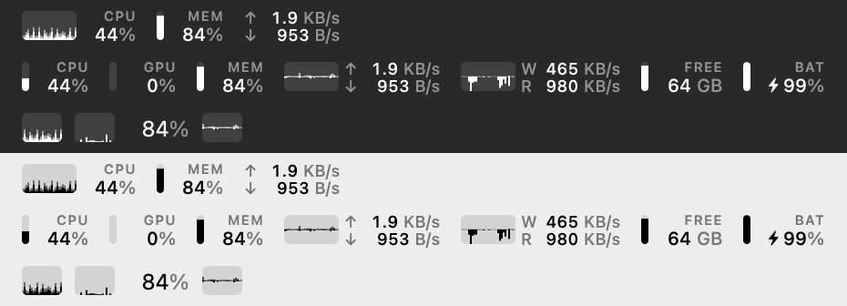
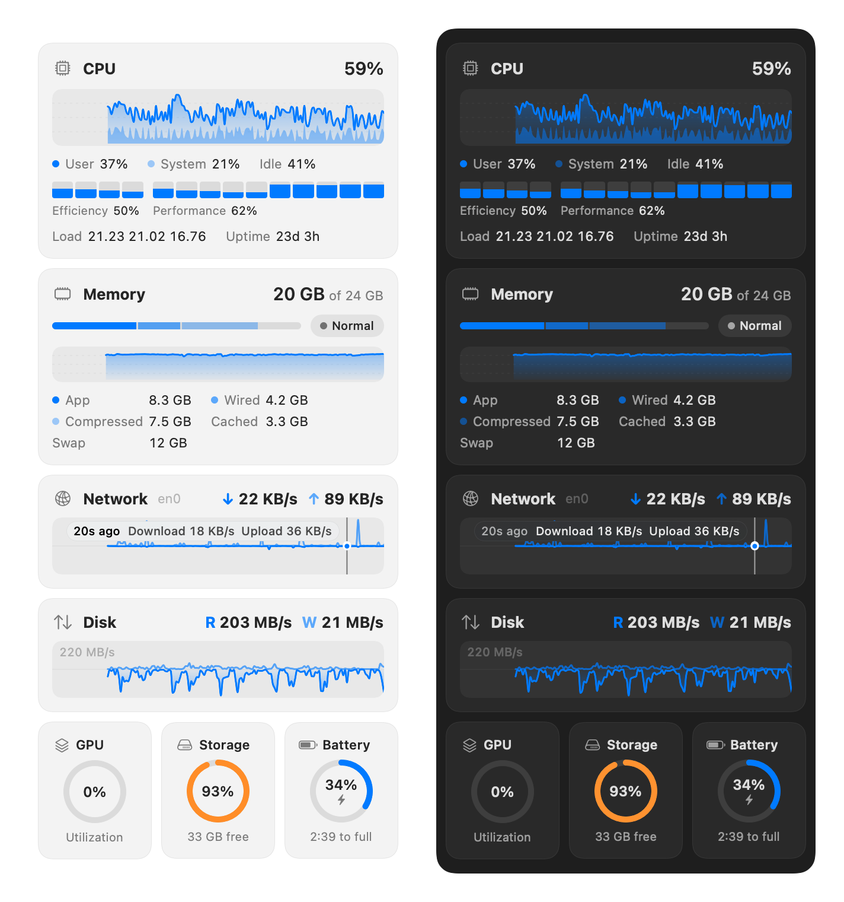

# Common Stats

[](https://github.com/oddurs/common-tools/actions/workflows/ci.yml)
[](LICENSE)

System stats in the macOS menu bar: CPU, GPU, memory, network, disk activity, storage, and battery. Small type, small graphs, nothing else. **[oddurs.github.io/common-tools/stats](https://oddurs.github.io/common-tools/stats/)** · [Docs](https://oddurs.github.io/common-tools/stats/docs/)



Common Stats is built to feel like part of macOS:

- **The menu bar draws it.** The bar is a template image, so macOS tints it for light and dark menu bars, dims it on inactive displays, and adjusts it for Increase Contrast, like the clock or Wi‑Fi.
- **The dropdown is a real menu.** It opens, tracks, highlights, and dismisses like every other menu bar extra, with ⌘, and ⌘Q. Charts use the colour chosen in Settings (your accent colour by default), and each chart has a legend.
- **Settings looks like System Settings.** Each metric gets a style (Value, Graph, Gauge, or Don't Show). Drag to reorder, or use Move Up and Move Down from the context menu or VoiceOver actions.
- **VoiceOver reads it:** "CPU 21%, Memory 82%, Network down 6.1 KB/s, up 1.0 KB/s".
- **Numbers follow your region:** "4,0 MB/s" in Germany, "4.0 MB/s" in the US.

Free forever and open source under the MIT licence. Private: no analytics, no crash reports, no account; nothing you do is ever reported. No network access, no helper tools, no root.

## Install

Requires macOS 14 or later.

1. Download [CommonStats.zip](https://oddurs.github.io/common-tools/stats/) from the [latest release](https://oddurs.github.io/common-tools/stats/), unzip it, and move **Common Stats** to Applications.
2. Open it. The build is signed but not notarized, so the first time macOS will say it can't verify the developer. Go to **System Settings › Privacy & Security** and click **Open Anyway**. Alternatively, run:

   ```sh
   xattr -dr com.apple.quarantine "/Applications/Common Stats.app"
   ```

3. Turn on **Open at login** in Settings.

## Usage

Click the item to open the dropdown. It shows cards and gauge tiles for the metrics in the bar, with history graphs; hover a graph to read back a past value. **Open Activity Monitor**, **Settings…** (⌘,), and **Quit** (⌘Q) are at the bottom.



Settings has four sections. **Items**: choose a style for each metric (Value, Graph, Gauge, or Don't Show) and drag to reorder. **Appearance**: **Show labels** and **Density**. **General**: **Open at login** and **Update every**. **Common Tools**: the other apps in the family, with **Open** for the ones installed and **Get…** for the rest, and Common Stats' version at the foot.

If the item lands behind the camera housing or a menu bar manager, open Common Stats again from Finder or Spotlight: that opens Settings, which says so while the item is hidden.

### Accuracy

Each figure comes from the same kernel source Apple's own tools use, and the tests compare Common Stats' figures against those tools.

| Metric | Source | Notes |
| --- | --- | --- |
| CPU | `host_processor_info` tick deltas | Wraparound-safe 32-bit tick arithmetic. Split into user and system time, plus per core. On Apple Silicon, cores are grouped into efficiency and performance clusters using the device tree's `cluster-type`. That mapping was checked by confining load to the efficiency cores with `taskpolicy -b`, and the tests check the counts against `hw.perflevel*`. |
| Memory | `host_statistics64` | Same split as Activity Monitor: App (anonymous − purgeable) + Wired + Compressed. RAM in binary units, so 24 GiB reads as 24 GB. Checked against `vm_stat`. |
| Network | `NET_RT_IFLIST2` sysctl, 64-bit counters | Primary interface only, so VPN traffic isn't counted twice. `getifaddrs` has 32-bit counters that wrap every 4 GB, so Common Stats doesn't use it. Checked against `netstat`. |
| Disk activity | `IOBlockStorageDriver` statistics, per disk | Deltas are taken per disk, so plugging a disk in or out can't show up as a burst of I/O. |
| GPU | `IOAccelerator` performance statistics | The driver's own utilisation figure. |
| Storage | `volumeAvailableCapacityForImportantUsage` | The figure Finder shows. |
| Battery | IOKit power sources | Time remaining is shown only once macOS has an estimate. |

Rates divide by the time that actually passed (a monotonic clock that keeps counting through sleep), not by the nominal interval. A gap longer than 10 seconds, such as after sleep, restarts the baseline, so a burst isn't averaged over time nobody saw. A value Common Stats can't read shows as a dash, never as a made-up zero.

#### Not included, and why

- **Temperatures and fans.** Apple Silicon has no public API for them. The private sensor interfaces change between releases, and a figure that is silently wrong is worse than none.
- **Top processes.** Without root, macOS hides usage for about a fifth of processes, including WindowServer and kernel_task, which are often the busiest. A list without them would be misleading. Use **Open Activity Monitor** in the menu.

### Performance

On an M4 Pro:

- Sampling all seven metrics takes about 0.1 ms. Drawing the bar takes about 0.3 ms.
- The process uses about 0.5% of one core and 12 MB of memory. Most of that CPU is macOS compositing the menu bar item, which every menu bar extra pays.
- Drawing stops while the item can't be seen (behind the notch, collapsed, or under a full-screen app). Sampling continues, so the graphs have no gaps.
- In Low Power Mode, Common Stats samples half as often. Sampling stops while the displays sleep.
- The timer has leeway, so macOS can batch Common Stats' wakeups with other work.

The test suite fails if sampling or drawing gets about 10× slower. A leak test runs an hour's worth of samples (3,600) and fails if memory grows.

## Build from source

The Command Line Tools are enough; Xcode is not required.

```sh
scripts/task build stats  # universal build → build/stats/Common Stats.app
mv "build/stats/Common Stats.app" /Applications/
```

## Development

Common Stats lives in `apps/stats/` of [oddurs/common-tools](https://github.com/oddurs/common-tools), the monorepo for every Common Tools app, and shares [CommonKit](../../packages/CommonKit) with them. From the repository root:

```sh
scripts/setup                       # once: wire the git hooks
scripts/dev-cert                    # optional, once: a stable signing identity, so permissions survive rebuilds
scripts/task run stats              # build, quit the running copy, open the new one
scripts/task check stats            # lint + test + build, what CI runs for this app
scripts/task test stats --filter=X  # only the tests whose name matches
```

See [CONTRIBUTING.md](../../CONTRIBUTING.md) for the workflow: `scripts/agent start`, `scripts/agent ship`, and `scripts/release stats <version>`.

`swift build && .build/debug/StatBar --snapshot out.png [seconds]` samples for a few seconds, then renders several bar layouts to `out.png` and every dropdown section to `out-menu.png`, each in light and dark. The images above were made this way. Use it to review design changes without screen-recording permission.

Layout:

- `Sources/StatKit`: samplers, history, layout model, and the menu bar renderer. Contains no UI state, so it can be tested on its own.
- `Sources/StatBar`: the status item, menu, and Settings window. The executable target keeps its original name, `StatBar`.
- `Tests/StatKitTests`: unit, accuracy, and performance tests.

## Licence

MIT. See [LICENSE](../../LICENSE).
